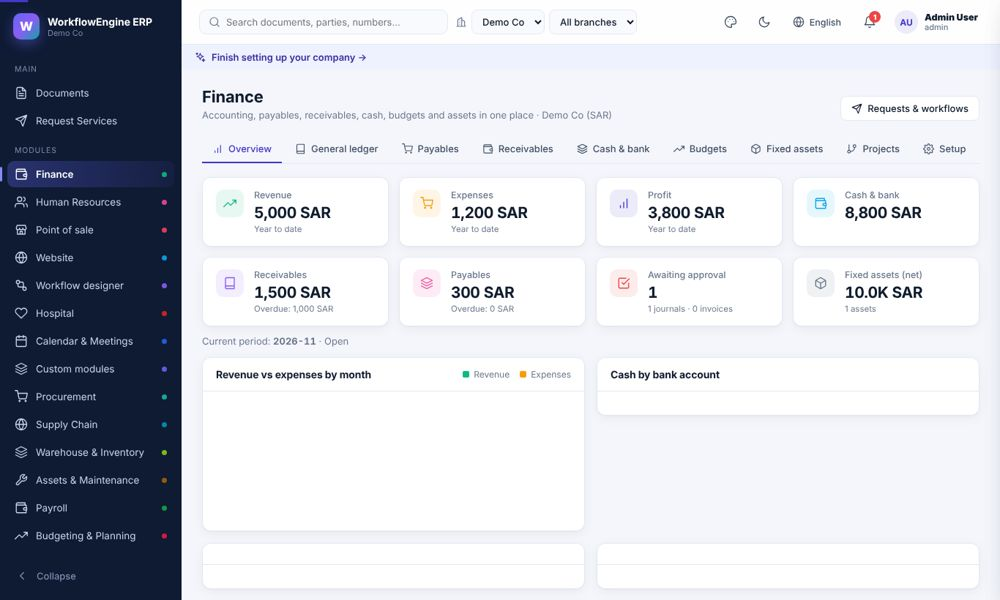
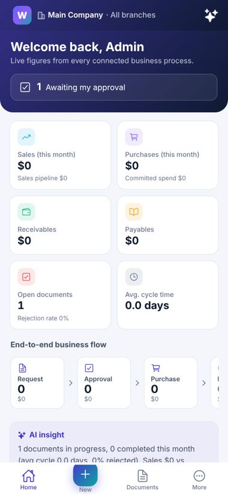
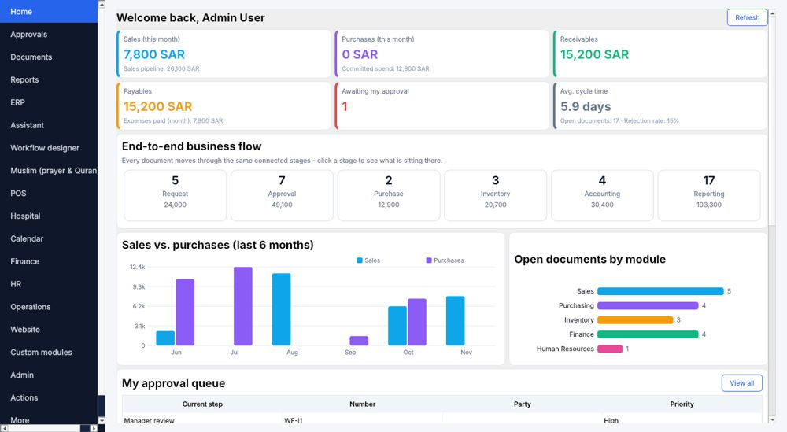

# Workflow ERP

A self-hosted business suite that combines a **workflow / BPM engine** (designer, forms, approvals, escalation) with a full set of **ERP modules**: finance, HR, point of sale, hospital, procurement, manufacturing, projects, CRM and more. It runs as a **web portal**, a **mobile app** and **desktop apps**, all talking to the same ASP.NET Core API, in English, Arabic (right to left) and other languages.

Everything starts with a request. A document or service request follows a published workflow through its approval steps, and the finished document posts to the ledger, stock or payroll. The rest of the system exists to make that path fast and auditable.

| Web portal | Mobile app | Desktop app |
|---|---|---|
|  |  |  |

More screens: [Receivables](WorkflowEngine/docs/screens/portal-receivables.jpg) · [HR recruitment board](WorkflowEngine/docs/screens/portal-hr-recruitment.jpg) · [Workflow designer](WorkflowEngine/docs/screens/portal-designer.jpg) · [Mobile finance](WorkflowEngine/docs/screens/mobile-finance.jpg) · [Desktop finance](WorkflowEngine/docs/screens/desktop-finance.jpg). The full set, with an explanation of every screen, is in the user guide (see [Documentation](#documentation)).

## What is in it

**Workflow engine**
- Visual flow designer: drag, connect, publish. Start, End, Form Task, Approval Task, conditions, parallel split / join, timer, email, webhook and automation nodes.
- Dynamic forms on task nodes, custom outcome buttons, task priority, time-based escalation or auto-complete on timeout.
- Task inbox per user or role; every run has a live status, a timeline and a process map.
- Ready-made templates: Leave Request, Clearance, Employee Transfer, New Start Work.

**ERP modules**
- **Finance:** general ledger, payables with three-way match, receivables, cash and bank, budgets, fixed assets and depreciation, period close, VAT, ZATCA e-invoicing.
- **Human Resources:** employees, organization, leave, performance, recruitment (hire / reject), payroll.
- **Point of sale:** till, shifts with cash count posting to finance, products, customers, promotions, stock.
- **Hospital:** patients, appointments, visits, laboratory, pharmacy, wards and beds, billing with printable invoices.
- **Operations:** procurement, supply chain, warehouse and inventory, manufacturing (BOM, MRP, work orders), projects and timesheets, CRM, assets and maintenance, real estate, archive and secretary.
- **Also:** calendar and meetings, website builder with an online shop, custom modules, Muslim tools (prayer times and the Quran), integration (API keys and signed webhooks), BI and analytics.

**Platform**
- Multi-company and multi-branch workspaces, setup wizard, invitations and billing plan.
- Privileges stored in the database and re-checked by the API on every request. The UI only hides things.
- Notes, attachments, saved filters and a report designer (print or save as PDF) on every list.
- An Assistant that answers from what the signed-in user may see. Set `ANTHROPIC_API_KEY` on the server to let it answer free-form questions.
- Languages: English, Arabic, French, Spanish, Urdu, German, Italian.

## Repository layout

Everything is under [`WorkflowEngine/`](WorkflowEngine).

| Folder | What it is |
|---|---|
| `backend/WorkflowEngine.Api` | ASP.NET Core 8 Web API: workflow engine, REST endpoints, EF Core on SQL Server |
| `backend-*` | Backend source packs and patch scripts for the modules (finance, HR, POS, real estate, security, onboarding and others) |
| `portal-app` | Angular 17 web portal (the full product) |
| `mobile-versions/ionic-capacitor` | Ionic 8 + Angular + Capacitor app for Android and iOS (the full mobile app) |
| `mobile-versions/react-native`, `flutter`, `dotnet-maui` | Smaller native mobile apps: sign-in, home, approvals, documents, generic ERP browser, settings |
| `desktop-versions/python-pyside6`, `cpp-qt`, `java-swing`, `csharp-wpf` | Four desktop apps with the same pages |
| `desktop-versions/shared`, `tools` | Shared JSON specs, the sync tool and `mock_server.py`, a fake API for trying the apps without the backend |
| `uat` | Load and acceptance test material |
| `user guide` | The user guides (Word and PowerPoint) |

## Getting started

**1. Database and backend** (needs the .NET 8 SDK and SQL Server)

```bash
# SQL Server in Docker, or point the connection string at an existing server
docker run -e "ACCEPT_EULA=Y" -e "MSSQL_SA_PASSWORD=YourStrong!Passw0rd" \
  -p 1433:1433 --name workflow-sql -d mcr.microsoft.com/mssql/server:2022-latest

cd WorkflowEngine/backend/WorkflowEngine.Api
# set ConnectionStrings:WorkflowDb and Jwt:Key in appsettings.json
dotnet restore
dotnet run
```

On start the API creates the schema, seeds demo accounts and the workflow templates. **Change `Jwt:Key` and the sample connection string before using this anywhere real.** See [`WorkflowEngine/README.md`](WorkflowEngine/README.md) for the demo accounts and the engine details.

**2. Web portal**

```bash
cd WorkflowEngine/portal-app
npm install
npx ng serve      # http://localhost:4200
```

The API address is set in `src/environments/environment.ts`.

**3. Mobile app**

```bash
cd WorkflowEngine/mobile-versions/ionic-capacitor
npm install
npx ng serve                  # run in a browser
npx ng build && npx cap sync  # then open the Android or iOS project
```

**4. Desktop apps**: pick one in `WorkflowEngine/desktop-versions`. `python-pyside6` runs with `pip install -r requirements.txt` then `python main.py`. Each folder has Windows `run.bat` / build scripts; see [`desktop-versions/README.md`](WorkflowEngine/desktop-versions/README.md).

**Try it without the backend.** The desktop and mobile apps work against a small fake API:

```bash
python3 WorkflowEngine/desktop-versions/tools/mock_server.py 5055    # sign in as admin / admin
```

## Documentation

- **User guides** in [`WorkflowEngine/user guide`](WorkflowEngine/user%20guide):
  - `user guide all.docx` and `user guide all.pptx`: portal, mobile and desktop together, English then Arabic, with a linked index and an explanation of every module screen.
  - Separate Word guides for the portal and the desktop apps, in English and Arabic.
- [`WorkflowEngine/README.md`](WorkflowEngine/README.md): workflow engine features, templates and how to run the backend.
- [`WorkflowEngine/MODULES.md`](WorkflowEngine/MODULES.md): the ERP modules, privileges and integration API.
- [`desktop-versions/README.md`](WorkflowEngine/desktop-versions/README.md) and [`mobile-versions/README.md`](WorkflowEngine/mobile-versions/README.md): what each app covers.

## Project status

This is a working project, not a finished product. Please read this before relying on it.

- **Backend:** the module packs added after the original engine were written without a .NET SDK to hand and have only been syntax-checked. Build once and fix any compile errors.
- **Desktop apps:** the Python, C++/Qt and Java versions have been run or smoke-tested. The C#/WPF version is written but **has not been compiled**.
- **Mobile apps:** the Ionic app builds. React Native type-checks. Flutter and .NET MAUI are written but not compiled.
- **Still only in the web portal:** drag-and-drop website design and picture upload, per-user privilege editing, the e-invoice QR drawing, the calendar month grid and reminder pop-ups, supplier-invoice approve / hold / pay, and consolidation reports.
- **Not done:** Quran hizb marks.

## Contributing

Issues and pull requests are welcome. Keep the desktop apps in step with the portal by editing the JSON in `desktop-versions/shared` and running `tools/sync_shared.py` rather than editing copies.

No licence file is included yet. Add one before others reuse the code.
